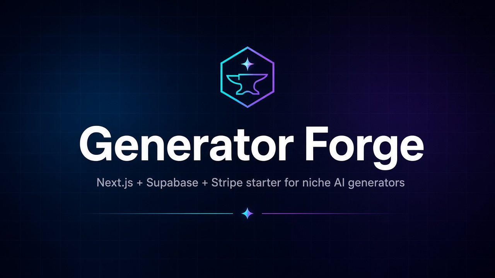
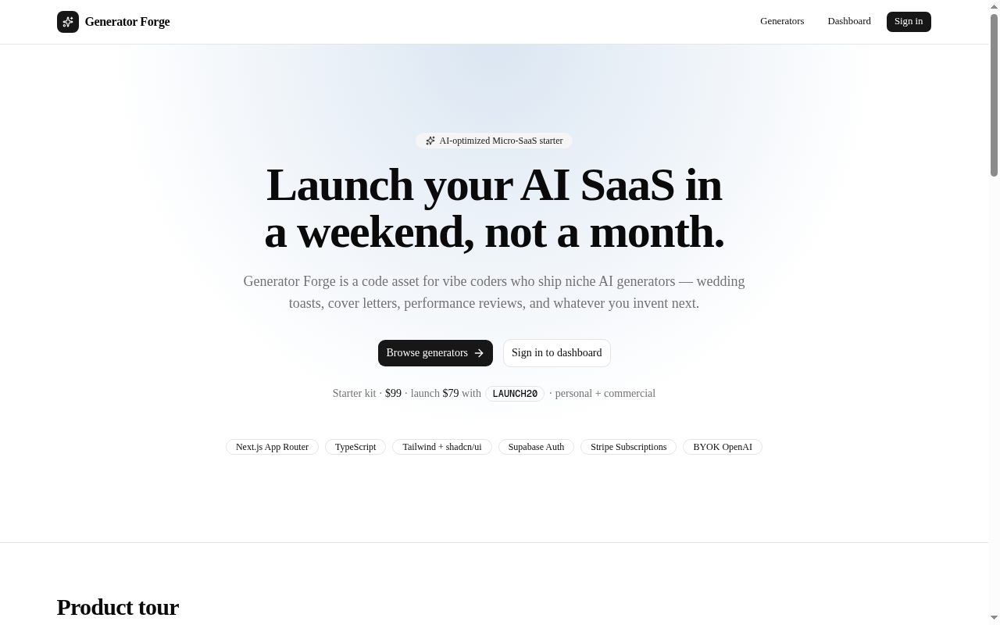
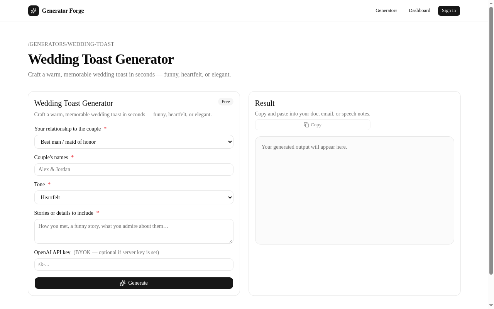
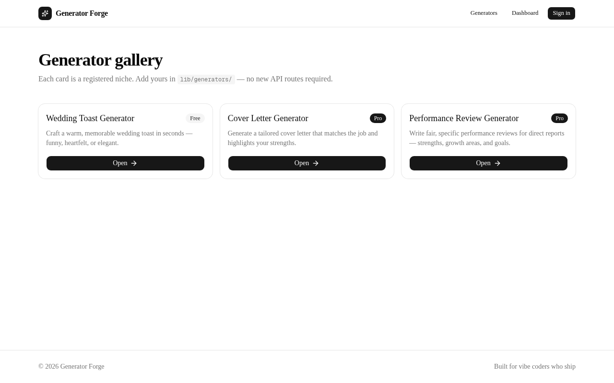

<p align="center">
  
</p>

<h1 align="center">Generator Forge</h1>

<p align="center">
  <strong>A Next.js + Supabase + Stripe starter for shipping niche AI generator apps. Launch your AI SaaS in a weekend, not a month.</strong>
</p>

<p align="center">
  <a href="https://generator-forge.vercel.app"></a>
  &nbsp;
  <a href="https://dbtaametrics83.gumroad.com/l/adxarv"></a>
</p>

<p align="center">
  <a href="https://generator-forge.vercel.app">Live demo</a> ·
  <a href="https://dbtaametrics83.gumroad.com/l/adxarv">Buy on Gumroad ($99, one-time)</a> ·
  <a href="#faq">FAQ</a>
</p>

> **Heads up:** this repository is a public showcase (screenshots, feature overview, and docs summary). It does **not** contain the application source. The full codebase is delivered via [Gumroad](https://dbtaametrics83.gumroad.com/l/adxarv).

---

## What it is

Generator Forge is a code asset for indie hackers and vibe coders who launch small, focused AI tools: wedding toasts, cover letters, performance reviews, and whatever niche you think of next. Auth, subscriptions, and a reusable generator pipeline are already wired up, so a new niche comes down to writing one template and registering it. No new API route, no new form component.

Try the free **Wedding Toast** generator on the live demo: <https://generator-forge.vercel.app/generators/wedding-toast>

## Screenshots

| Landing page | Generator (fields → prompt → result) | Generator gallery |
|---|---|---|
|  |  |  |

## Features

- **Generator factory.** One shared generate endpoint and one reusable form. Each niche is a template (fields, prompts, free/Pro flag) that gets its own page at `/generators/[slug]`.
- **3 example generators.** Wedding Toast (free), Cover Letter (Pro), and Performance Review (Pro).
- **SEO-ready niche pages.** Every generator page has its own title and description metadata, so each niche can work as a landing page.
- **Supabase Auth.** Magic link sign-in, with optional Google OAuth.
- **Stripe subscriptions.** Checkout, the Customer Portal, and a webhook that syncs subscription status to the user's profile.
- **Free vs. Pro gating.** Pro generators are locked server-side until the user has an active subscription. You decide which niches are free.
- **BYOK OpenAI.** Users bring their own OpenAI API key, with an optional server key for demos. You aren't reselling AI credits.
- **Dashboard.** A signed-in area with a BYOK demo chat.
- **Built for AI-assisted coding.** Ships with a `.cursorrules` file, an env template, and a SQL schema, so Cursor and similar tools understand the project's conventions from the start.
- **Docs.** Quick start, an add-a-generator walkthrough, an FAQ, and a license.
- **Deploys to Vercel.** Standard Next.js deploy, with step-by-step notes for production Supabase redirects and Stripe webhooks.

## Stack

| Layer | Tech |
|---|---|
| Framework | Next.js (App Router), React, TypeScript |
| UI | Tailwind CSS, shadcn/ui |
| Auth & database | Supabase (Auth + Postgres) |
| Payments | Stripe (Checkout, subscriptions, webhooks, Customer Portal) |
| AI | OpenAI, bring-your-own-key |
| Hosting | Vercel (or any Next.js host) |

## How the factory works

1. **Write a template.** Give it a slug, a title, SEO copy, form fields, a system prompt, and a user prompt with `{{field}}` placeholders. Mark it free or Pro.
2. **Register it.** Add the template to the generator registry.
3. **Ship it.** `/generators/your-slug` now exists, with the form, the generation endpoint, Pro gating, and page metadata already handled.

Here's roughly what a template looks like:

```ts
// ILLUSTRATIVE ONLY: a simplified sketch of the idea, not code from the product.
const podcastShowNotes = {
  slug: "podcast-show-notes",
  title: "Podcast Show Notes Generator",
  free: false, // Pro-only: requires an active Stripe subscription
  fields: [
    { name: "episodeTitle", label: "Episode title", type: "text" },
    { name: "transcript", label: "Transcript or rough notes", type: "textarea" },
  ],
  systemPrompt: "You write tight, skimmable podcast show notes.",
  userPrompt: "Write show notes for '{{episodeTitle}}' using: {{transcript}}",
};
```

The real templates, types, registry, and API route come with the purchased source.

## What's included / not included

**Included in the Gumroad download**

- The full Next.js app (TypeScript, Tailwind, shadcn/ui)
- Supabase auth flows and a SQL schema with a profile-on-signup trigger
- Stripe Checkout, Customer Portal, and webhook handling
- The generator factory plus 3 example niches (1 free, 2 Pro)
- The BYOK dashboard chat
- Docs (Quick Start, Add a Generator, FAQ, License), `.cursorrules`, and an env template
- 30 days of email support for setup questions

**Not included (v1)**

- A hosted or managed SaaS (you deploy your own copy)
- Teams/organizations, admin panels, a blog, or email marketing
- OpenAI credits (BYOK)
- Multi-tenant white-labeling
- Custom feature builds or design work

## License

**This showcase repo:** the README text and images here are © 2026 bzucker4, all rights reserved. See [LICENSE](LICENSE).

**The purchased source (summary):** buyers get a personal and commercial license to build, host, and sell their **own** products made with Generator Forge, with unlimited deployments for their own brands. You may not resell or redistribute the starter itself as a competing boilerplate or template. The full license text ships with the download.

## FAQ

<details>
<summary><strong>Is the source code in this repo?</strong></summary>

No. This repo is only a showcase. The complete source is delivered when you buy on [Gumroad](https://dbtaametrics83.gumroad.com/l/adxarv).
</details>

<details>
<summary><strong>How much does it cost?</strong></summary>

$99, one-time. No subscription.
</details>

<details>
<summary><strong>Do I need an OpenAI account?</strong></summary>

Yes, for real generations. Generator Forge is BYOK: users paste their own OpenAI API key into the form, and you can set a server key for demos. Keys go with each request and aren't stored by default.
</details>

<details>
<summary><strong>Can I use it for client work or commercial products?</strong></summary>

Yes. You can build and sell your own niche AI products, and hire contractors to work on your private copy. You just can't resell the starter itself as a kit.
</details>

<details>
<summary><strong>How do free vs. Pro generators work?</strong></summary>

Each template has a free/Pro flag. Free generators work for everyone. Pro generators are blocked server-side until the user's Stripe subscription is active, and the webhook keeps that status in sync.
</details>

<details>
<summary><strong>Where can I deploy it?</strong></summary>

Vercel works out of the box, and so does any host that runs Next.js. The docs walk through production env vars, Supabase redirect URLs, and the production Stripe webhook.
</details>

<details>
<summary><strong>What's the refund policy?</strong></summary>

If the project won't install or run after you follow the Quick Start, contact support within 14 days of purchase with the error details and you're covered.
</details>

<details>
<summary><strong>What support is included?</strong></summary>

30 days of email help with setup: env vars, the Supabase schema and auth redirects, Stripe prices and webhooks, and adding new generators. Custom feature builds aren't included.
</details>

---

<p align="center">
  <a href="https://generator-forge.vercel.app"><strong>See the live demo →</strong></a>
  &nbsp;&nbsp;|&nbsp;&nbsp;
  <a href="https://dbtaametrics83.gumroad.com/l/adxarv"><strong>Get the full source on Gumroad →</strong></a>
</p>
